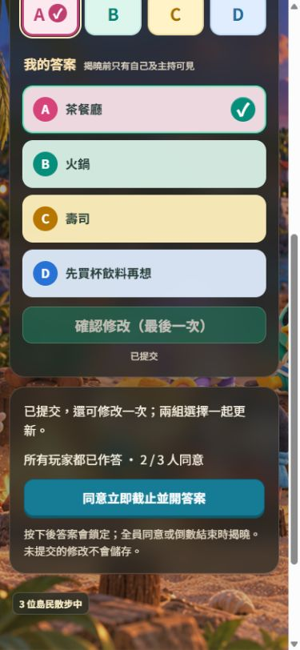

# 一次修改與全員同意截止

適用於選邊站／輪流猜主角（`/room`）；12 幕冒險的作答方式不變。

## 玩家操作

1. 選擇自己的答案及預測，一起提交。收到確認後顯示「已提交」。
2. 截止前可再修改一次，兩組選擇一起更新；不改任何選擇不會消耗次數。畫面顯示「確認修改（最後一次）」。
3. 修改成功後鎖定；重整、重新連線或另一分頁不會重置修改次數。
4. 主角首次提交後仍不可修改，也必須參與同意截止。
5. 所有仍在本題房間的參加者都已作答，才顯示「同意立即截止並開答案」。
6. 按下同意會鎖定自己的已提交答案（尚未提交的修改不儲存）。同意不能撤回；全員同意才提前揭曉。畫面顯示同意人數。
7. 倒數到零仍自動揭曉；主持人可照常手動提前截止及揭曉。需保持正式主持頁開啟並連線，才能執行自動結算；重新連線後恢復處理。

中途加入者也需要提交及同意；被主持人移除的玩家不再計入。離線但未移除的人仍算參加者，可等待倒數結束，不會永久卡住。

## 資料與規則

- 私人答案增加 `revision`：首次 0、唯一一次修改 1。既有無 revision 的答案視為首次提交；新版規則不允許舊客戶端無限覆寫。
- 公開 `/room/public/earlyClose` 保存房間、題次、attempt、ready 及同意記錄，不含任何未揭曉答案。
- ready 只由主持人發布。玩家只可新增自己的同意，不能撤回、代替他人同意或更改 ready。
- 規則以伺服器時間驗證期限、目前題次及身分，拒絕同意後改答、重置次數、刪除答案、第二次修改及離線過期補送。
- 主持人在房間交易內重新核對所有有效答案與同意，才截止與結算；結算可重試而不重複加分。主持人本身是可信管理員，其管理權限仍保留。
- 官方依據：[規則條件](https://firebase.google.com/docs/database/security/rules-conditions)、[資料交易](https://firebase.google.com/docs/database/web/read-and-write)。

## 測試

- 隔離發布版本的 57 項單元測試及正式建置通過。
- Firebase Emulator 全套 41 項通過，包括 10 個獨立身分全員同意、少一票不揭曉、重複結算、修改限制、假冒同意、隱私與離線過期拒絕。
- 本機模擬介面實測：390×844 首次提交、修改一次、重整鎖定及最後一人同意揭曉；360×800、430×932 同意按鈕及揭曉無水平溢出。
- 本機模擬的其他玩家由測試 fixture 驅動，不能視為正式 Firebase 多人實測。真實手機與 OBS 尚未實測。

## 發布順序

活動結束或暫停出題後，先在 Firebase Realtime Database「規則」貼上本版本完整 `database.rules.json` 並發布，再部署網站。主持頁與玩家頁都須重新整理，避免舊主持頁沿用「全員作答就揭曉」的邏輯。UID 與密碼不需更改。

