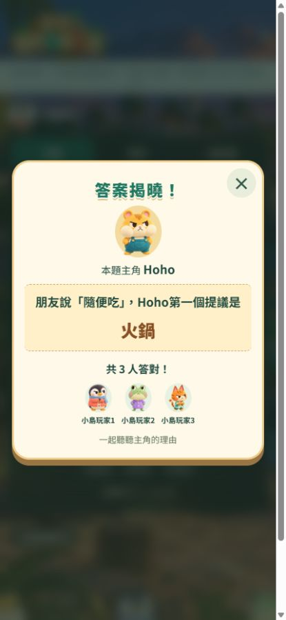

# 裝置尺寸驗證（2026-10-15）

本次針對輪流猜主角的倒數、選項及揭曉 popup。使用本機隔離的模擬房間及實際 app 元件，未寫入正式 Firebase。測試快照以既有發布版加上本次 CSS 修正建立，沒有混入其他進行中的題庫改動。

| 畫面 | 尺寸 | 結果 |
| --- | --- | --- |
| 平板直向 | 768×1024、820×1180 | 倒數可見、選項無水平溢出，選答與提交成功，popup 在視窗內 |
| 平板橫向 | 1024×768、1180×820 | 同上 |
| 手機橫向 | 667×375、844×390 | 修正後倒數在初始視窗內；上下捲動可完成兩組選答及提交；popup 改為左右排列 |
| 直播展示頁 | 1920×1080 | 倒數及四個選項完整可見；20 人場景的揭曉 popup 位於視窗內 |
| 手機直向回歸 | 390×844 | 20 人揭曉內容與關閉按鈕在視窗內，關閉功能正常 |

## 修正

- 矮橫向視窗縮減頁首、題目與主角區的高度，倒數下緣由約 399px 改至 301px。
- 橫向 popup 將主角與答案／答對名單左右排列。一般四人場景的 popup 高約 261px，667×375 可完整顯示。
- 20 人的橫向答對名單有自己的捲動區（100px 顯示高度、269px 內容高度）。答案與關閉按鈕不受名單長度影響。
- Popup 內容與關閉按鈕分開；過長內容可以捲動，關閉按鈕保留在卡片右上角。

## 方法與限制

- 六種平板／橫向手機尺寸均實際點選預測及個人答案，提交後核對「已提交」。
- 以 DOM 幾何量測及截圖檢查溢出，並檢查長暱稱與 20 人名單。
- 截圖 fixture 暫停 popup 入場動畫以量測最終位置；正式 CSS 的動畫及減少動態效果規則保留。
- 隔離發布快照 `npm run build` 通過。本次只改版面，不更動 Firebase 規則。
- 這是桌面瀏覽器視窗模擬，並非真實 iPad、iPhone、Android 或 OBS 實機測試；瀏覽器工具列、觸控鍵盤、安全區及 OBS 瀏覽器來源仍需實機確認。
- 本次響應式修正獨立發布到 GitHub Pages；發布流程會重新執行單元測試、Firebase Emulator 測試及正式建置。未修改資料庫規則。

## 手機直向完整補測

使用同一隔離版本，補測 360×800、390×844、430×932：

- 三種尺寸倒數均在初始視窗內（下緣約 386px），頁面及選項均無水平溢出。
- 預測 A–D 與個人答案 A–D 逐一點選，捲動到提交按鈕後提交，三種尺寸均收到模擬 backend 的「已提交」。這不是正式 Firebase 多人測試。
- 使用縮短至 4 秒的本機測試倒數，確認歸零後顯示「時間到」，選項及提交停用。
- 一般揭曉 popup、答案、答對名單與關閉按鈕在視窗內；三種尺寸均實際關閉成功。
- 20 人及長暱稱壓力場景：360px 的 popup 內容區高度 758px、內容 865px，以內部捲動呈現；390px、430px 可容納該測試名單。三種尺寸的關閉按鈕均可操作。
- 未發現需新增 CSS 修正的問題，沿用上次的 popup 內部捲動設計。完整作答區需正常垂直捲動，不是全部選項都擠在首屏。
- 本次仍是瀏覽器尺寸模擬，未覆蓋實體手機瀏覽器工具列、鍵盤或觸控手勢。

